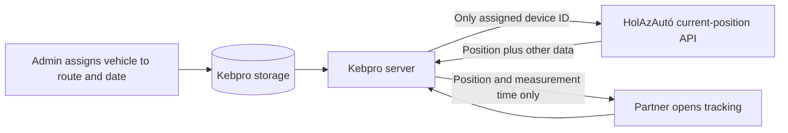

# HolAzAutó integration: execution and provider questions

Status: proposed design for review. No application code has been changed, no live API request has been made, and no message has been sent to HolAzAutó.

This document extends [the tracking requirements and visual plan](HOLAZAUTO-VEHICLE-TRACKING-PLAN.md). A partner with a delivery order can see only the vehicle assigned to that order's route, throughout the delivery date in Budapest time, and only within 20 km straight-line distance of their delivery address. There is no additional hour-of-day restriction. The partner should receive an alert when the vehicle enters that radius. Assignments do not move with rescheduled routes.

## Recommended connection

Kebpro's server should be the only party that connects to HolAzAutó. It logs in, reuses the token, requests the position of the one device assigned to the eligible delivery, and sends the partner's browser only the position and its measurement time. The browser should never receive a HolAzAutó login, token, raw provider response, or selectable fleet list.

The PDF specifies login at `POST /proxy/services/v2/session/apilogin`, and current positions at `GET /proxy/services/v2/positions/current` using `assetClass=DeviceAsset` and `assetIds`. It describes a reusable token, but does not establish its lifetime or the exact behavior of every error. The example returns `dynamicValues.lastPosition` with latitude, longitude and timestamp, alongside data we must discard. The provider must confirm the account-specific behavior before we rely on it.

## How a request should work

1. The logged-in partner opens the delivery card. The server obtains the current date in `Europe/Budapest` and rejects location access if it is not the order's delivery date.
2. The server finds the partner's own order for today, requires an actual order with a reliable route ID, and checks the route and the assignment for that exact date. Archived orders remain valid unless a separate confirmed cancellation rule says otherwise. An absent or ambiguous route ID is not sufficient to grant access.
3. The server obtains the device ID from the assignment, not from partner input. It requests that one device from HolAzAutó. It validates that the returned device key matches and that coordinates and the measurement timestamp are plausible.
4. After the upstream request completes, it reloads the session and approved user, and rechecks time, order, route and assignment using a coherent database snapshot. Compare the assignment's stable identity or revision, not just the vehicle ID, so a removal and recreation is detected. If the check fails, discard the result. A change immediately after the final check can still race with the response, so this is not an absolute instant-revocation guarantee.
5. If still authorized, calculate straight-line distance to the order's trusted delivery-address coordinates on the server. Only if the valid, sufficiently fresh vehicle position is at most 20 km away, return latitude, longitude and the measurement timestamp, with `Cache-Control: no-store`. Outside the radius or when coordinates are missing or unreliable, return a status with no vehicle coordinates. Do not return speed, ignition, driver, path, provider ID or other telemetry. Location is displayed with the actual measurement time, never with the request time substituted for it.
6. Stop refreshing when the card is hidden, the partner leaves, the session ends or the delivery date ends. The server remains the authority even if a browser's clock is incorrect. Remove the visible marker on expiration or loss of access.

An already displayed position cannot be recalled remotely. With polling, assignment or account changes become visible to an open browser on its next refresh unless another notification mechanism is added; a known logout or the end of the delivery day clears the marker without waiting. Prevent delayed or out-of-order responses from restoring an older marker after a newer state or date change.

## 20 km alert and automatic map updates

The partner does not need to press a button to refresh. While the map is open and active, it checks automatically at a sensible interval. Outside 20 km the server returns a waiting state, not the location. Once within 20 km, the map displays and continues to update the car while the other access conditions remain satisfied. Clear the marker if a fresh check shows it has moved outside the radius or access has ended; a browser may continue showing the last result until its next check.

For an alert when the portal is closed, a reliable server-side scheduled worker must check active assigned routes and qualifying orders throughout the delivery date, independently of any partner viewing the page. For each eligible partner, compare a recent vehicle position against that order's delivery-address coordinates, and queue a generic push notification when first detected within 20 km. The worker must check current assignment, order and partner eligibility again before dispatch, and discard queued alerts at the end of the delivery date or when eligibility changes. Do not include coordinates or sensitive vehicle data in the notification. Clicking it opens the portal, which repeats all access, date, freshness and distance checks.

Recommended default: one notification per partner per delivery date, even if the car leaves and re-enters the radius or is replaced. If first checked already within 20 km, send once; do not send using stale, missing or invalid positions. Store a durable idempotency key and coordinate worker leases across instances to reduce duplicates; retries and external delivery still cannot guarantee exactly-once delivery. Push delivery can be delayed or missed, and a notification already handed to a push service cannot always be recalled. Bound its expiry to the end of the delivery date and avoid promising immediate or guaranteed delivery.

Geocode the actual delivery address associated with the order, preserving a reliable mapping between that address and coordinates. Validate results; provide staff a way to correct failures and re-geocode when an address changes. Do not silently use a different address when the delivery address is missing or ambiguous. Select the geocoding/map provider after reviewing pricing, privacy and terms. Phone GPS is not required.

The project already has a push subscription flow, service worker, notification dispatcher and worker scaffolding. Live push is configuration-dependent and may run in simulation; inspect the actual deployment rather than assuming it is active. The existing dispatcher currently recognizes limited notification categories and uses a general 24-hour age limit; this new category needs specific eligibility, deduplication, retry and delivery-day expiry behavior. A reliable scheduled worker or external scheduler is required, particularly on serverless hosting. Verify HTTPS, subscription/permission state, and real Android/iPhone delivery; on supported iPhones web push requires installation to the Home Screen. Do not assume a closed PWA can run its own continuous GPS polling.

### Provider availability and efficiency

- **Token:** keep it server-side in memory, reuse it, and coordinate concurrent login attempts within each running process. On an authentication failure, retry login once only after confirming which response means token expiry; do not loop indefinitely. Multiple application instances may each have a token; check provider limits and whether concurrent sessions are supported.
- **Requests:** initially propose refreshing every 60 seconds while the map is visible, subject to HolAzAutó's update interval and usage limits. Coalesce concurrent requests for the same device within a process and optionally keep a brief in-memory position cache. Each partner request still requires its own fresh authorization checks. An in-memory cache is per process, so aggregate request volume must be checked for the deployed number of instances.
- **Timeout and failure:** propose a short upstream timeout, such as five seconds, and no repeated automatic retries for an unavailable provider. Show a neutral temporary-unavailability state; an upstream failure must not block ordering or the rest of the portal. Avoid sending raw provider errors to partners.
- **Old data:** propose hiding the marker once a position is older than five minutes and showing an outdated status with its measurement time. The threshold depends on normal device reporting intervals and remains to be confirmed. If the timestamp is missing or invalid, do not display a live marker.
- **Capacity example:** at a 60-second interval, one continuous viewer would cause up to 1,440 provider position requests over a 24-hour delivery day without caching or coalescing; background monitoring, additional viewers, routes and server instances can multiply traffic. Actual traffic depends on active viewers and deployment. Verify aggregate provider quota before enabling it.
- **Provider boundary:** use a fixed approved HTTPS origin; disable redirects or strictly limit them to that origin. Bound response size and parse device key, coordinates and timestamp strictly; never accept a different device's data.

## Concrete fit with this application

- Existing orders are stored as `responses` and normally carry the route ID, partner ID, delivery date and `kind`. New order creation resolves a specific route; older responses may lack a route ID. Existing code normally permits one response per partner and delivery date; do not assume this prevents all legacy or imported conflicts. Fail closed for ambiguous records.
- `portal/domain.js` already uses `Europe/Budapest`, and `deliveryOn()` incorporates route reschedules. Its `deliveries()` helper begins tomorrow, so a dedicated today-eligibility check is needed instead of reusing the upcoming-delivery list unchanged.
- The existing reschedule function can move route-less responses using partner membership, which is ambiguous for partners with multiple routes. A moved date alone does not establish the order's route. Flag such records for staff correction before relying on them for tracking; do not infer eligibility from the reschedule.
- The SQLite prototype stores one state document. Postgres splits collections into rows and uses selective partner/admin reads. Both need explicit persistence and migration work, including a safe uniqueness rule for a route/date assignment. Postgres write operations already use a transaction-wide advisory lock; implement and verify the invariant within the actual write paths, including imports and migrations.
- Prefer a database uniqueness constraint for route and date where the selected Postgres schema permits it. Validate the same invariant for SQLite state, imports, migrations and restores; reject conflicting data safely instead of picking an arbitrary vehicle.
- `store.change()` callbacks must be synchronous in both stores. Never hold the store mutation transaction or lock open during an external HolAzAutó request. Read eligibility before the call and re-read after it, then release the response only if the checks still pass.
- Staff audit snapshots currently cover a fixed list of fields. Extend them to record assignment changes without coordinates, credentials or tokens. Include the new data in backups and restoration tests.
- The portal's configuration loader uses an explicit allowlist. Any new server-only provider settings and feature flag must be added to that loader and documented in the appropriate environment examples without committing credentials.
- The partner service worker currently caches the offline shell, not API responses. Preserve that and ensure browsers, intermediaries, logs and analytics do not retain tracking responses or coordinates.

## Suggested implementation steps after approval

1. **Provider discovery:** obtain the base URL, approved test credentials and a test device ID; confirm the questions below. Make a controlled single-device test from the server environment. Record only sanitized results. Do not use production credentials in tests or screenshots.
2. **Data and admin:** create the server-side vehicle catalog and dated assignments, with SQLite and Postgres support, migration, backups and staff audit. Build the date/route/vehicle selection, replacement and removal. Do not assign automatically on a reschedule.
3. **Policy:** implement and test a single server-authoritative eligibility check for session, order, delivery date, route, assignment and 20 km radius. Handle reschedules, archived orders, invalid legacy route IDs and conflicting records.
4. **Provider adapter:** implement server-side authentication, one-device position lookup, bounded timeouts, minimal data handling and safe error handling. Use a fake provider in automated tests.
5. **Address and partner interface:** geocode and validate the actual delivery address, implement server-side 20 km checks, and add an automatically updating map with one marker, measurement time and clear waiting/unavailable/outdated states. Select a map service after reviewing its pricing, terms, coverage, content security policy and privacy implications. Tile requests can expose the viewed area and client IP to that service.
6. **Background alerts:** add scheduled route checks, per-delivery deduplication, delivery-day-aware push expiry and dispatch-time eligibility checks. Verify the actual hosting scheduler and live push configuration.
7. **Verify and pilot:** run policy, API, distance-boundary, persistence, concurrency, notification and delivery-day-boundary tests; test both storage backends, browser network/caching and mobile layout. Enable the feature behind a server-side flag for a small pilot using a real assigned vehicle and authorized partners, then expand after review.

## Questions to send HolAzAutó

This is a draft for the owner to review or send. Nothing has been sent.

> Tisztelt HolAzAutó Csapat!
>
> A partnerportálunkban a Fleet API 2.5 segítségével szeretnénk a kiszállító jármű aktuális helyét megjeleníteni. A járművet egy konkrét túrához és naphoz rendelnénk, és csak az aznapi, adott túrára szóló kiszállítási rendeléssel rendelkező partnerek látnák, amikor a jármű legfeljebb 20 km-re van a kiszállítási címtől. A partner csak a helyet és annak mérési idejét látná; sebességet, sofőradatot és útvonal-előzményt nem.
>
> Kérjük segítségüket az alábbiakban:
>
> 1. Mi a fiókunkhoz tartozó API base URL, és hogyan kaphatunk megfelelő jogosultságú teszt-hozzáférést?
> 2. Hol találjuk az egyes járművekhez tartozó `DeviceAsset` azonosítókat? Van támogatott járműlista-végpont, amely név vagy rendszám és eszközazonosító párosítását is visszaadja?
> 3. A `positions/current` válaszban fiókunknál minden érintett eszköznél a `dynamicValues.lastPosition` tartalmazza az aktuális koordinátákat és a GPS-mérés idejét? Mi a különbség ennek időbélyege és a `lastGps` között?
> 4. A válasz szűkíthető-e úgy, hogy koordinátát és mérési időt kapjunk, de sofőr-, sebesség- és egyéb adatot ne? A dokumentált opcionális paraméterek közül melyek használhatók úgy, hogy a pozíció megmaradjon?
> 5. Mennyi ideig érvényes a token, milyen státuszkód vagy hibaválasz jelzi a lejáratát, és használható-e párhuzamosan több szerverpéldányról?
> 6. Milyen kérési és bejelentkezési korlátok, díjak, ajánlott lekérdezési gyakoriság és jellemző GPS-frissítési idő vonatkozik a fiókunkra?
> 7. Van-e sandbox vagy külön tesztjármű, illetve szükséges-e IP-engedélyezés, külön szerződés vagy egyéb beállítás a partnerportálon történő megjelenítéshez?
>
> Köszönjük a segítséget!

## Review points before work starts

- The plan was reviewed with the separate “HolAzAutó implementation.” Codex chat. Its feedback is incorporated above. That chat reviewed the project but could not independently extract the PDF; the API descriptions here come from our earlier PDF review and still need account-specific verification.
- The 60-second refresh, five-second timeout and five-minute stale threshold are proposals, not confirmed provider capabilities or agreed product rules.
- The provider account, service URL, device mapping, quotas and terms are still unknown. Ask the owner to supply credentials through an appropriate secure channel; never paste them into this document.
- A map provider and any cost, licensing and privacy requirements are still to be selected. Confirm the treatment of cancellation statuses and ambiguous historical orders before enabling tracking.
- The execution plan is ready for owner review. Begin implementation only after the owner confirms.
