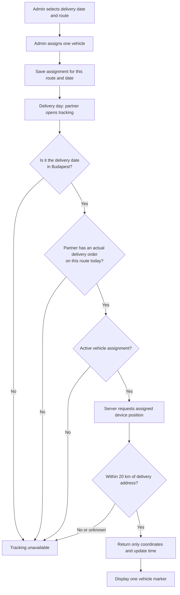
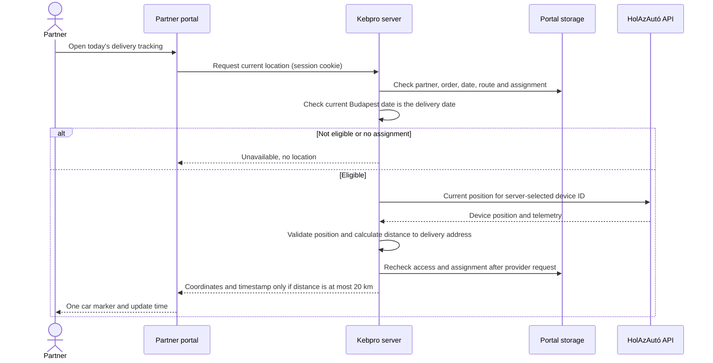

# Delivery vehicle tracking: requirements and implementation plan

Status: planning only. No tracking integration has been implemented.

## Agreed behavior

- An admin assigns one vehicle to a particular route and delivery date, normally one day before delivery. An assignment applies only to that date; it must never recur automatically.
- A logged-in partner may see the vehicle only when they have an actual delivery order for that route and date. A skipped delivery, no order, or an order for another route does not qualify.
- The vehicle's most recent valid position must also be within **20 km straight-line distance of that order's delivery address**. Determine distance on the server before returning any coordinates. Missing or unreliable delivery-address coordinates fail closed.
- While the eligible partner has the tracking view open, update the location automatically; a manual refresh button is not required. Outside 20 km, show a waiting message without returning the vehicle position.
- Send an eligible partner a push notification when their assigned vehicle is detected within 20 km, even if the portal is closed, subject to notification permission, a valid subscription and a working background service. Propose one alert per partner and delivery date, with durable deduplication; confirm the repeat policy before implementation.
- Access is available throughout the delivery date, from 00:00 inclusive until the next midnight exclusive, in `Europe/Budapest`. There is no additional hour-of-day restriction; the server enforces the delivery date and 20 km radius on every request.
- The partner sees only the currently assigned vehicle's location on a map and its position update time. Do not expose speed, ignition, driver, other telemetry, travel history, other vehicles, or provider credentials.
- A rescheduled route does not carry its vehicle assignment to the new date. The admin makes a new assignment if needed. A stale assignment on the original date must not grant access after the delivery has moved.
- An admin may replace or remove an assignment. Subsequent location requests must recheck access; a marker already delivered to an open browser can remain visible until the next refresh unless the browser learns of the change sooner. Clear it at a known logout or the end of the delivery day. Already disclosed information cannot be recalled.

## Visual plan: day before and delivery day



```mermaid
timeline
    title Delivery tracking timeline - Budapest local time
    Day before : Admin assigns vehicle to route and delivery date
    Delivery day 00:00 to midnight : Eligible partners see location within 20 km and can receive an alert
    Next day : Location unavailable
```

## Visual plan: proposed screens

These are functional sketches, not final designs. Hungarian copy should be refined to match the existing portal.

```text
ADMIN - delivery route                         Delivery date: 2026-11-12
┌──────────────────────────────────────────────────────────────────────┐
│ Route: Budapest és környéke                                          │
│ Assigned vehicle: [ Vehicle 1                         v ]             │
│                                                                      │
│ [Assign vehicle]       [Remove assignment]                           │
│ Tracking: delivery day, within 20 km of delivery address             │
└──────────────────────────────────────────────────────────────────────┘

PARTNER - delivery day, eligible and within 20 km
┌──────────────────────────────────────────────────────────────────────┐
│ Kiszállító jármű                                                     │
│                                                                      │
│                        MAP                                           │
│                       [car]                                          │
│                                                                      │
│ Utolsó helyadat: 10:24                                               │
└──────────────────────────────────────────────────────────────────────┘
```

When there is no assigned vehicle, show a neutral unavailable message. More than 20 km away, show a waiting message, not the location. Distinguish an unavailable provider, missing address coordinates or an old GPS reading from a current location; do not label an old reading as live. Outside the delivery date, stop displaying the location and remove the marker even if the page stays open. Map choice, exact wording, refresh interval and freshness threshold are implementation decisions to validate.

## Existing application and integration points

- `portal/domain.js` defines Budapest local time, route schedules and rescheduling, partner route selection, and order responses. Existing `deliveries()` starts from tomorrow, so it is not sufficient for today's tracking eligibility.
- Orders/responses contain `partnerId`, `date`, `routeId` and `kind`; `kind: 'order'` is the starting point for a qualifying delivery. `kind: 'skip'` is not eligible. Orders can be archived; archiving alone must not revoke a real delivery order. Confirm any other cancellation or delivery status semantics during implementation.
- Some legacy responses may lack `routeId`. Do not guess a vehicle from a partner's general route membership when the order's route is ambiguous. Resolve or migrate legacy data only when its route can be established safely; otherwise fail closed and let staff correct it.
- `portal/app.js` already has authenticated partner and staff endpoints. Add separate staff assignment and partner location endpoints using the existing session and authorization middleware.
- `portal/react/Home.tsx` is a candidate for the partner tracking card; the admin delivery/route view is the candidate for assignment controls. Adapt the existing client types, API and loading code as needed.
- The SQLite store and Postgres store use different persistence paths. Add explicit migrations, read/write support, backups and tests for both. In particular, Postgres collection mapping and selective `readPartner`/`readAdmin` queries must include the new data where needed; do not assume adding a property to state is sufficient.
- The partner service worker currently caches its offline shell rather than API responses. Preserve that property; location data and tracking responses must not be cached for offline use.

## HolAzAutó API findings

Source: `C:\Users\Horváth Levente\Downloads\HolA_API_20261103.pdf`, Fleet API 2.5, especially pages 1-5.

- Login: `POST /proxy/services/v2/session/apilogin`, with JSON `loginName`, `password`, `systemTag: "HOLA"`, and `client-type: HOLAFLEET_API`. The returned token can be reused.
- Current location: `GET /proxy/services/v2/positions/current` with `assetClass=DeviceAsset` and the specific `assetIds`, and token plus `client-type: HOLAFLEET` headers. Omitting `assetIds` requests every device, so never omit it in the partner lookup.
- The documented response is keyed by `positions.DeviceAsset_<ID>` and includes `dynamicValues.lastPosition.latitude`, `longitude` and `timestamp`. It can also contain speed, ignition, person and other sensitive fields. Whitelist the required output; never forward the provider response.
- Do not assume optional field-suppression parameters preserve the location: verify the real account's response and parameter behavior first, especially because `lastPosition` is nested under `dynamicValues` in the example.
- The PDF uses a `<baseurl>` placeholder. Obtain the real base URL, API account, permitted device IDs, token-expiry behavior, request limits and any provider-specific restrictions from HolAzAutó or the account owner. Use a restricted account if the provider supports it. The PDF does not establish a suitable vehicle-list endpoint for this use case; a staff-managed name-to-device-ID list is a practical initial option.

## Technical design



1. **Vehicle catalog and assignments.** Store a staff-controlled vehicle label and provider `DeviceAsset` ID, plus a dated assignment with route ID, delivery date, vehicle reference and audit information. Enforce at most one active assignment per route/date atomically; validate the route, date and vehicle. Do not expose the catalog or device IDs to partners. Assignment changes should be audited without logging locations or credentials.
2. **Authorization.** Derive the partner ID from the session and the date from trusted server time, never from a partner-supplied vehicle or partner ID. Check an actual qualifying order and its route/date, current route schedule including reschedules, and an active dated assignment. Define a safe behavior if multiple qualifying routes exist on one day: require an unambiguous qualifying delivery selection and return only the vehicle for that delivery; never list other route vehicles. Recheck after the external call so a reassignment, order change, or date change during an in-flight request cannot leak a now-unauthorized position.
3. **Provider adapter.** Keep the base URL and credentials in server environment/secrets, not source control or browser code. Use HTTPS, a reusable server-side token, bounded timeout and controlled retry/re-login on verified authentication failure. Do not log tokens, raw responses or position coordinates. Handle invalid responses, missing or stale timestamps and upstream errors without leaking provider details.
4. **Minimize and protect data.** Validate coordinate ranges and timestamps; return a small explicit DTO containing only location and position update time. Use `Cache-Control: no-store`, no URL parameters containing location, no persistent location history, and no location in analytics, audit records or error logs. A short in-memory provider cache may reduce load if needed, but must not bypass authorization, reassignment, freshness, delivery-date or distance checks. Rate-limit access and coordinate refreshes across multiple viewers; verify provider limits.
5. **Map and browser behavior.** Choose a map provider after checking cost, coverage, licensing, CSP and privacy. Map tile requests may reveal the viewed area and client IP to the map provider; disclose and assess this before launch. Refresh only when the card is visible and on the delivery date. Hide the marker on expiration, logout, authorization failure or reassignment until fresh authorized data arrives. Server enforcement remains authoritative regardless of browser clock or refresh behavior.
6. **Rescheduling.** Do not copy an assignment to the new date. Suppress or remove the old assignment when a route moves and ensure it cannot authorize access on the original day; make the admin assign the new date explicitly. Ensure the reschedule and assignment changes are consistent if an operation fails.
7. **Radius and notifications.** See the execution plan for address geocoding, server-side distance checks, background monitoring and notification deduplication. Never include the vehicle position in an outside-radius response or push notification.

## Implementation sequence

1. Confirm provider access and test an account-specific, single-device current-position request without exposing credentials. Establish rate limits, update frequency, device identifiers and token failure behavior. Select a map provider and review its terms and privacy impact.
2. Add the vehicle catalog and dated assignments with migrations, constraints, store queries, backup support and audit events for both persistence backends.
3. Implement a pure server-side eligibility policy and protected staff assignment operations. Handle rescheduling, order changes, archival and legacy missing-route data explicitly.
4. Add the provider adapter and protected location endpoint, including authorization checks before and after the upstream call, minimal responses, timeouts and error handling.
5. Add admin assignment controls and the partner's delivery-day map and status states. Ensure the UI handles the end of the delivery day without a reload.
6. Test, deploy behind a feature flag, pilot with one vehicle and a small set of authorized partners, and expand only after verifying real device freshness, isolation and provider usage.

## Acceptance and security checks

- An otherwise eligible partner can access the location throughout their delivery date, including at 08:00 and 16:00, but not before that date or from the next midnight. Test Budapest date boundaries, daylight-saving transitions and a browser left open across midnight.
- Test distances below, exactly at, and above 20 km, missing/incorrect address coordinates, vehicle crossing the boundary and leaving again, stale positions and direct endpoint access. Only a fresh position at or under 20 km may be disclosed. Test automatic updates with the view open and background alert delivery with it closed.
- A partner with a real order for today's assigned route sees its assigned vehicle. Partners with no order, a skip, another date or another route cannot obtain it, including by directly calling the endpoint or changing request parameters.
- Archived qualifying orders remain eligible; test any other order states against confirmed delivery semantics. Ambiguous or missing legacy route IDs do not grant access.
- Test partners with multiple route memberships and, if possible, multiple same-day deliveries. Never return a different route's car or the provider's full fleet.
- Replacement, removal, changed orders, disabled sessions and rescheduling prevent new location disclosure at the final authorization check. A marker already displayed is cleared on the next refresh or when a change is otherwise known; polling cannot guarantee instantaneous revocation. Clear at a known logout or end of delivery day, and discard delayed or out-of-order responses. A change immediately after the final check can still race with a response.
- Missing assignment, unavailable provider, invalid coordinates and old GPS data produce an appropriate non-misleading status. Test token expiration, timeouts, concurrent requests and provider throttling.
- Inspect network responses, browser caches, logs and offline behavior: no provider token, device catalog, speed, driver data, path history or other telemetry reaches partners; no cached location is accessible after expiry.
- Run the relevant automated portal tests, TypeScript check, store tests on SQLite and Postgres, and desktop/mobile walkthroughs. Add focused integration tests with a fake provider; use an authorized real-device pilot for final verification.

## Decisions and dependencies before launch

- Obtain API base URL, account, device IDs, provider limits and token-expiry details; verify response structure using the actual account.
- Choose a map provider, refresh interval and maximum acceptable position age, and review cost, licensing and privacy implications.
- Confirm how any cancellation or delivery-specific statuses affect eligibility. The agreed default is an actual `kind: 'order'` on the delivery date and route; archival alone does not cancel delivery.
- Confirm the operational handling of rare multiple same-day qualifying deliveries and any legacy orders without a reliable route ID. The safe default is to deny ambiguous access rather than select a vehicle by guesswork.
